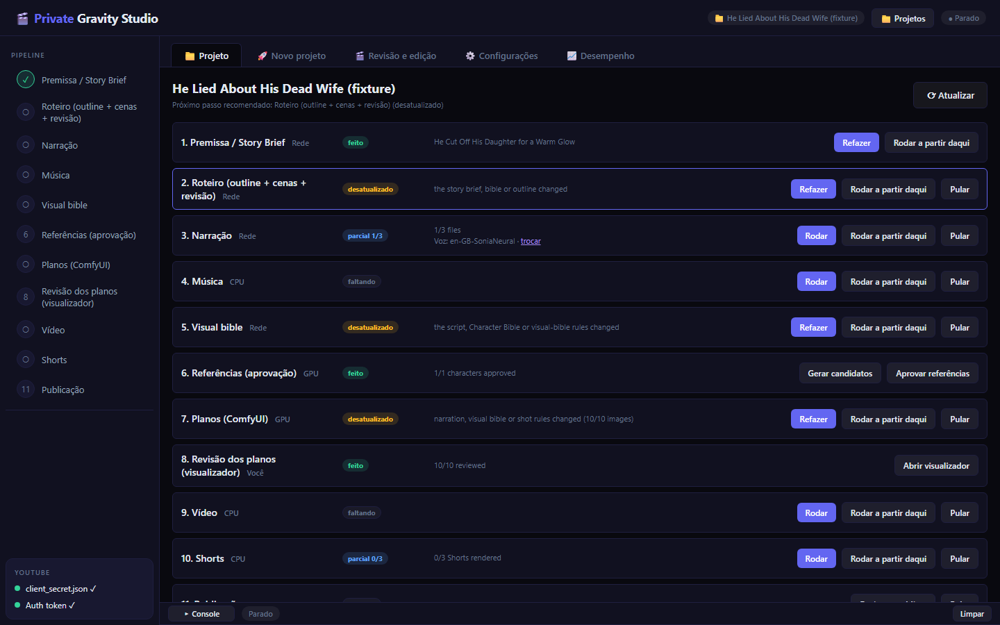
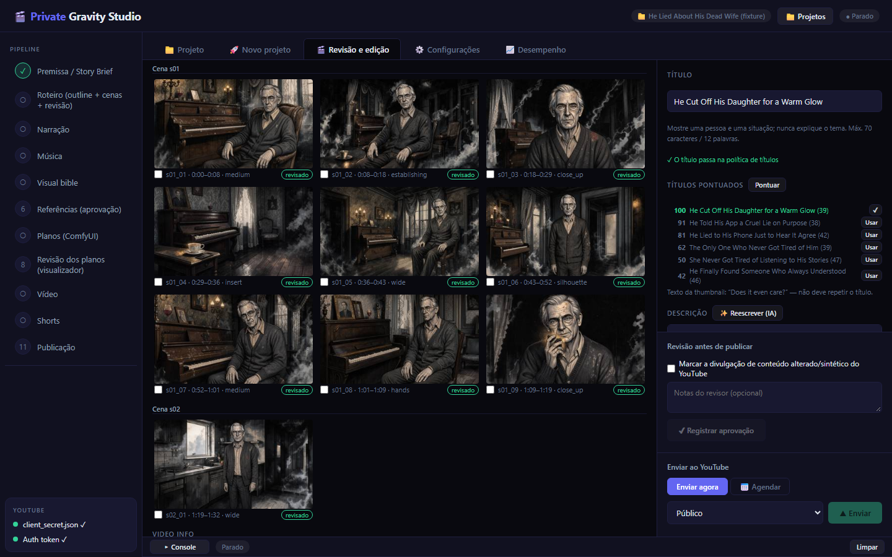
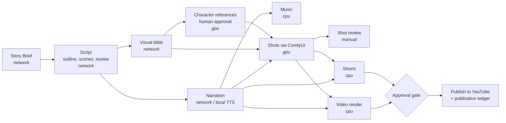

<div align="center">

# Private Gravity Studio

**An agentic, human-in-the-loop production pipeline that turns a story premise into a narrated, illustrated, reviewed and published YouTube episode.**

Gemini writes and reviews, ComfyUI draws, Kokoro narrates (all local except Gemini), and nothing reaches YouTube without a human approval bound to the exact files that will be published.

[](https://python.org)
[](https://aistudio.google.com)
[](https://github.com/comfyanonymous/ComfyUI)
[](#testing)
[](LICENSE)

Built on [raunakpatil/youtube-agentic-ai-studio](https://github.com/raunakpatil/youtube-agentic-ai-studio) (MIT). See [Credits and what changed](#credits-and-what-changed).

</div>

---

## In production

This studio produces **Private Gravity**, an English-language anthology of original cinematic psychological fiction: standalone stories where psychological and philosophical ideas surface through character choices and consequences, never through lectures. Some published episodes:

- [The Man Who Needed Everyone to Envy Him](https://www.youtube.com/watch?v=w-XazyuEUv8)
- [He Cut Off His Daughter for a Warm Glow](https://www.youtube.com/watch?v=Sc3IbtGx-6k)
- [Everyone Heard What He Thought](https://www.youtube.com/watch?v=WKswj78bnKo)
- [They Paid the Ferryman to Forget](https://www.youtube.com/watch?v=Fsy9Md4a4yw)

| Project view: every stage, its state and what made it stale | Shot review, title scoring and the approval gate |
|---|---|
|  |  |

> The studio UI is in Portuguese (the operator's language); the content it produces, the code and this documentation are in English.

---

## How it works

Each episode is a **project** with eleven stages. Stages know their inputs, so when an upstream artifact changes, everything downstream is marked stale and can be re-run from that point instead of starting over. Each stage runs in a lane (network, GPU, CPU or manual) so long jobs don't block each other.



### 1. Story engine (`agents/`)

- **Story development:** develops an exact premise, or a detailed premise brief, into a validated Story Brief with a specific psychological angle, title candidates and thumbnail text.
- **Narrative architecture:** character bible, causal outline and scene-batched screenplay, each with a versioned JSON contract. Three episode types (realistic psychological fiction, philosophical thought experiment, dark human parable), with structural guidance injected from a single editorial identity source (`agents/identity.py`).
- **Cold open:** episodes can open on a teaser from the reversal, with deterministic checks that the teaser never gives away the payoff.
- **Review in two layers:** deterministic validators (word budgets, chronology, prose lint, title policy, quoted speech) plus an evidence-based LLM editorial review across 20+ dimensions. Findings are blocking, major or minor, and drive targeted revisions instead of full regeneration.

### 2. Images (`video/`)

- **Local generation** through ComfyUI's HTTP API with FLUX image models (`workflows/` holds the API graphs).
- **Visual bible:** immutable character looks, wardrobe per scene and recurring locations, plus approved style references, for consistency across shots.
- **Automatic visual QA** in layers: cheap deterministic checks, CPU face/person detectors (OpenCV), then a vision model (Gemini, or a local VLM through Ollama or ComfyUI). Rejected images are edited in place when possible instead of regenerated.
- Stock images (Pixabay, Openverse) remain as a fallback provider, with license provenance.

### 3. Narration and sound (`audio/`)

- **Pluggable TTS:** Kokoro (local ONNX, the channel voice), Chatterbox, Edge TTS and ElevenLabs behind one interface.
- Word-level alignment, a pronunciation dictionary, measured speech rate per voice for word-count planning, and an ASR plus acoustic check that catches stutters in each generated sentence.
- Music from a local library with ducking and loudness control.

### 4. Video (`video/`)

- Scene timing derived from the rendered narration, 2.5D parallax from depth maps, ambient overlays, captions and a film look applied in the final ffmpeg pass.
- Vertical Shorts planned and cut from the episode, with a rule that a Short never reveals the episode's twist.
- Thumbnails: three concepts per episode, generated, graded, lettered and checked for coherence with the video.

### 5. Publishing (`uploader/`)

- **Approval gate:** a reviewer checklist whose approval is bound to hashes of the script, video, title, description and thumbnail. Any change after approval invalidates it.
- **Publication ledger:** every upload is recorded, then synced with the YouTube Data API. A topic enters the banned-topics list only once the video is actually public, and re-syncing never duplicates entries.
- Scheduling, AI-content disclosure, chapters in the description, per-video analytics and an editorial record of the human's creative input.

---

## Engineering highlights

| Area | What was built |
|---|---|
| **Resilient LLM client** | Errors classified by cause (deadline, overload, rate limit, auth); deadline errors retried on the same model with a longer timeout and jittered backoff before falling back; accessible models discovered at runtime; per-call timing logs without prompt content. |
| **Structured outputs** | JSON stages with explicit contracts; repairs always resend the full contract and never truncated JSON; oversized repairs drop down to scene-level repair and merge back by `scene_id`, leaving valid scenes untouched. |
| **Deterministic before generative** | Cheap, testable validators run first; the LLM reviewer is asked for evidence (scene citations) and its findings feed bounded, targeted revisions. |
| **Local-first media** | Image generation, narration and most visual QA run on the local GPU/CPU; the paid API surface is limited to Gemini. |
| **Human in charge** | Approvals bound to content hashes, overrides only with a typed reason, recorded in the ledger. |
| **Resumable work** | Project folders, cached artifacts keyed by source hashes, `--resume` on long benchmarks, and debug dumps of raw model output on any failure. |
| **Spec-driven development** | Every phase was written as a design spec before implementation (see [`docs/prompts/`](docs/prompts)) and implemented with Claude Code under fixed rules: no live API calls in tests, never read secrets, one commit per section. |

---

## Testing

94 test modules with about 1,000 test cases. Every external service (Gemini, YouTube, ComfyUI, TTS, stock providers) is mocked, so the suite runs offline.

```bash
python -m unittest discover -s tests -p "test_*.py"
```

Live checks are opt-in and explicit (`--confirm-live`), for example the narrative benchmark in `scripts/regenerate_narrative_benchmark.py`.

---

## Quick start

**Requirements:** Python 3.10+, ffmpeg on the PATH, a Gemini API key, and for full local production a running ComfyUI with the FLUX model used by the graphs in `workflows/`, plus the Kokoro weights in `models/tts/` (Kokoro runs in its own virtual environment, `.venv-tts`). YouTube upload needs your own OAuth client (`client_secret.json`, never committed).

```bash
git clone https://github.com/comscijb/youtube-agentic-ai-studio.git
cd youtube-agentic-ai-studio
pip install -r requirements.txt
cp .env.example .env          # add GEMINI_API_KEY (and PIXABAY_API_KEY for the stock fallback)

python gui.py                 # studio at http://localhost:7070
# or create a project from a premise brief on the command line:
python -m scripts.project new --brief-file briefs/<brief>.md --minutes 11
```

Detailed setup is in [SETUP.md](SETUP.md). The full operations manual (projects, archiving, model fallback, benchmarks, review tooling) is in [docs/OPERATIONS.md](docs/OPERATIONS.md).

---

## Credits and what changed

This project started as a fork of **[youtube-agentic-ai-studio](https://github.com/raunakpatil/youtube-agentic-ai-studio)** by **Raunak Patil**, released under the MIT License, which is kept in [LICENSE](LICENSE). Thank you to Raunak and the original contributors.

| Original project | This fork |
|---|---|
| Single-pass research and script with Gemini | Multi-stage narrative pipeline with JSON contracts, deterministic validators, LLM editorial review and targeted revision |
| Edge TTS narration | Pluggable TTS with local Kokoro as default, alignment, pronunciation and stutter QA |
| Pixabay stock images with Ken Burns motion | Local FLUX generation via ComfyUI, visual bible, character references, layered visual QA, parallax motion and film look (stock kept as fallback) |
| Review dashboard and direct upload | Hash-bound approval gate, publication ledger synced with YouTube, banned topics on publication, analytics |
| One run per video | Projects with staged, resumable, dependency-aware production and a studio UI |
| No test suite | ~1,000 offline test cases |

Since the fork: 155 commits, 431 files changed, about 70,000 lines added.

---

## Author

**Jean G. Borges**, full stack developer (TypeScript, React, Node.js) working on applied AI.
[jeanborgesdev.com](https://jeanborgesdev.com) · [github.com/comscijb](https://github.com/comscijb)
